# Hi there 👋

My name is Dmitrii Safronov.

I build systems that survive their creators.

Repositories are artifacts. The interesting part is the topology between them.

## Engineering principles

### Constraints

- Contracts must be explicit and enforceable
- Configuration is part of the system contract
- Operational behavior must be observable

### System properties

- Portability is a system property
- Observability is architecture, not tooling
- Schemas are operational artifacts
- Configuration is validated before execution

### Operational assumptions

- Applications should not depend on reading their own runtime state
- Integration boundaries must be explicit
- State minimization is preferred over state synchronization
- Invalid configuration must fail fast

## Systems and tooling by theme

- [Python: Logging objects with schema (library)](https://github.com/disafronov/python-logging-objects-with-schema)
- [ETL: prometheus2clickhouse](https://github.com/disafronov/etl-prometheus2clickhouse)
- [AI tools](https://github.com/disafronov?tab=repositories&q=ai&type=source)
- [Flux2 tools](https://github.com/disafronov?tab=repositories&q=flux2&type=source)
- [Helm charts](https://github.com/disafronov/helm-charts)
- [Ansible roles](https://github.com/disafronov?tab=repositories&q=ansible_role&type=source)
- [Ansible templates](https://github.com/disafronov?tab=repositories&q=ansible&type=template)
- [Docker tools](https://github.com/disafronov?tab=repositories&q=docker&type=source)
- [Dummy apps](https://github.com/disafronov?tab=repositories&q=dummy&type=source)
- [GitHub Actions](https://github.com/disafronov?tab=repositories&q=GitHub+Action&type=source)
- [Home Assistant](https://github.com/disafronov?tab=repositories&q=home-assistant&type=source)
- [Forks](https://github.com/disafronov?tab=repositories&type=fork) | [Archived](https://github.com/disafronov?tab=repositories&type=archived)

### Template propagation

To avoid maintaining shared workflows and configurations separately across repositories, changes are propagated through a hierarchy of versioned templates.

Dedicated synchronizers handle propagation, shown as edge labels in the diagram below.

```mermaid
flowchart TB
    BT["basic-template"]
    SBT["semantic-basic-template"]

    SST["semantic-shell-template"]
    SDT["semantic-docker-template"]
    ART["ansible_role-template"]
    APT["ansible_project-template"]
    ULT["update_lists-template"]
    TST["template_sync-template"]

    BT -->|"template_sync-basic"| SBT

    SBT -->|"template_sync-semantic-basic"| SST
    SBT -->|"template_sync-semantic-basic"| SDT
    SBT -->|"template_sync-semantic-basic"| ART
    SBT -->|"template_sync-semantic-basic"| APT
    SBT -->|"template_sync-semantic-basic"| ULT
    SBT -->|"template_sync-semantic-basic"| TST

    SBT -->|"template_sync-semantic-basic"| OM["opencode-memoir"]
    SBT -->|"template_sync-semantic-basic"| DJ["django-telegram-q2"]
    SBT -->|"template_sync-semantic-basic"| OH["omniroute-hybrid-setup"]
    SBT -->|"template_sync-semantic-basic"| BM["… other repositories"]

    SST -->|"template_sync-semantic-shell"| SIMPLE["simple-sandbox"]
    SST -->|"template_sync-semantic-shell"| SHELL["shell-tools"]
    SST -->|"template_sync-semantic-shell"| SM["… other repositories"]

    SDT -->|"template_sync-semantic-docker"| SK["skilled"]
    SDT -->|"template_sync-semantic-docker"| DM["… other repositories"]

    ART -->|"template_sync-ansible_role"| ROLES["Ansible roles · …"]
    APT -->|"template_sync-ansible_project"| PROJECTS["Ansible projects · …"]

    ULT -->|"update_list-sync"| LISTS["List consumers · …"]

    TST -->|"template_sync"| TS["template_sync-*"]
    TST -->|"template_sync-template_sync"| TSM["Other synchronizers · …"]

    classDef template fill:#dbeafe,stroke:#2563eb,color:#1e3a8a,stroke-width:2px
    classDef receiver fill:#f3f4f6,stroke:#9ca3af,color:#111827

    class BT,SBT,SST,SDT,ART,APT,ULT,TST template
    class OM,DJ,OH,BM,SIMPLE,SHELL,SM,SK,DM,ROLES,PROJECTS,LISTS,TS,TSM receiver
```

## Latest [blog](https://cyberbrain.cc) posts
<!-- BLOG-POST-LIST:START -->
- [A working workaround isn’t always a good workaround](https://cyberbrain.cc/2026/10/14/A-working-workaround-isnt-always-a-good-workaround.html)
- [Настройка доступа к Ingress нескольких кластеров Kubernetes, находящихся в сети за NAT](https://cyberbrain.cc/2023/12/14/%D0%BD%D0%B0%D1%81%D1%82%D1%80%D0%BE%D0%B9%D0%BA%D0%B0-%D0%B4%D0%BE%D1%81%D1%82%D1%83%D0%BF%D0%B0-%D0%BA-ingress-%D0%BD%D0%B5%D1%81%D0%BA%D0%BE%D0%BB%D1%8C%D0%BA%D0%B8%D1%85-%D0%BA%D0%BB%D0%B0%D1%81%D1%82%D0%B5%D1%80%D0%BE%D0%B2-kubernetes-%D0%BD%D0%B0%D1%85%D0%BE%D0%B4%D1%8F%D1%89%D0%B8%D1%85%D1%81%D1%8F-%D0%B2-%D1%81%D0%B5%D1%82%D0%B8-%D0%B7%D0%B0-nat.html)
- [Проходные выключатели без проводов](https://cyberbrain.cc/2022/01/17/prohodnye-vyklyuchateli-bez-provodov.html)
- [Моё приложение для Android прошло государственную регистрацию](https://cyberbrain.cc/2021/06/10/moyo-prilozhenie-dlya-android-proshlo-gosudarstvennuyu-registraciyu.html)
- [Как отключить отображение системных пользователей на экране входа в систему &lpar;LightDM&rpar;](https://cyberbrain.cc/2020/08/04/kak-otklyu-chit-otobrazhenie-sistemnyh-polzovatelej-na-jekrane-vhoda-v-sistemu-lightdm.html)
<!-- BLOG-POST-LIST:END -->
